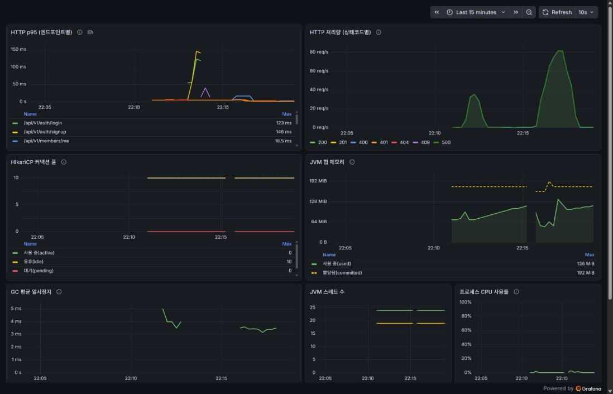
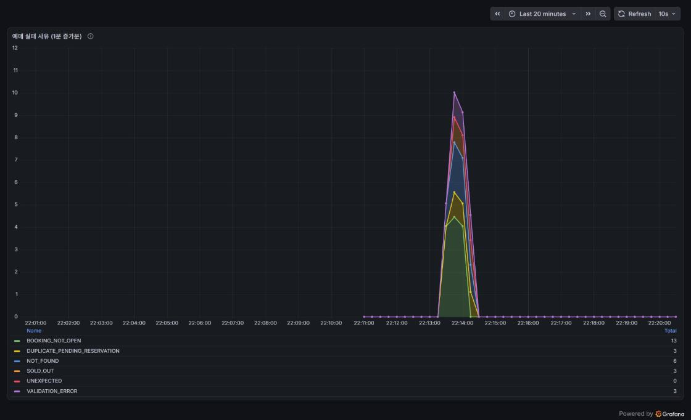

# 004_3. 모니터링 구축 — 계측을 넣고 나서야 "안 보이던 것"이 뭐였는지 알았다 (Task 025)

| | |
|---|---|
| 관련 Task | Task 025 (Phase 7: 운영 기반) |
| 대상 코드 | `tikkit-back/build.gradle`, `application.yml`·`application-dev.yml`·`application-prod.yml`, `SecurityConfig.java`, `ReservationService.java`, `docker-compose.prod.yml`, `ci.yml`, `monitoring/**`, `.env.example` |
| before 기준선 | [004_2. 컨테이너화 및 로컬 운영 스택](./004_2-containerization.md) — 기동 4.414초, 4개 healthy 24초, 테스트 123개, e2e 3개 5.5초, BE 이미지 137MB |
| 결론 | **계측을 넣는 일보다 "계측이 거짓말하는 경우"를 잡아내는 데 시간이 더 들었다.** p95가 모든 엔드포인트에서 4.8ms로 똑같이 나왔는데 값이 아니라 버킷 경계를 읽고 있었고, 헬스체크 트래픽이 지표에 섞여 있었고, 한 번도 안 터진 실패는 "0"이 아니라 아예 시리즈가 없었다. 셋 다 대시보드는 멀쩡해 보이는 상태로 틀린다 |
| 작성 시점 | 2026-10-11 |

## 1. 왜 만들었나

Task 024까지 와서도 백엔드에 **관측성이 한 줄도 없었다.** actuator·micrometer 의존성 0건,
`application*.yml` 4개 전부에 `management:` 블록 없음, 커스텀 메트릭·`HealthIndicator`·
로깅 필터 0건. `@Slf4j`를 쓰는 클래스가 `GlobalExceptionHandler`, `ReservationService`,
`ReservationExpiryScheduler` 셋뿐이었다.

그래서 다음 질문들에 답할 수단이 없었다.

- 좌석맵 조회(응답 59KB)가 목록 조회보다 느린가? 얼마나?
- Hikari 풀 기본값 10이 오픈런 트래픽에 충분한가?
- 예매 실패가 **좌석 경쟁**(`SOLD_OUT`) 때문인가 **중복 선점 가드**(`DUPLICATE_PENDING_RESERVATION`)
  때문인가? 둘은 원인도 대응도 완전히 다르다

ROADMAP:288-290이 요구한 것이 정확히 이것이다.

```
- **Task 025: [BE] 모니터링 구축**
  - Actuator + micrometer-prometheus 연동, compose에 Prometheus·Grafana 추가
  - 대시보드: HTTP p95, HikariCP 풀, JVM, 예매 성공/실패 카운터
```

선행 Task들이 넘긴 숙제도 함께 닫았다.

| 출처 | 넘긴 항목 |
|---|---|
| `004_2-containerization.md:386` | compose 헬스체크를 `/actuator/health`로 이전. **5초 주기 헬스 트래픽이 지표에 섞인다** |
| `004_1-spring-boot-4-migration.md:309` | Actuator 엔드포인트와 Micrometer 지표명이 **Boot 4에서 바뀐 것** 확인 |
| `application-prod.yml:41` 주석 | 구조화 로깅과 파일 출력 판단 |

**이 Task는 "개선"이 아니라 계측 도입이다.** 그래서 before/after도 성능 개선 수치가 아니라
① 계측을 넣은 비용 ② "측정 불가 → 측정 가능"으로 바뀐 항목, 두 축으로 적었다(7절).

산출물은 Task 026의 측정 도구가 된다. BE 2대 + nginx로 Redis 세션 vs JWT 지연을 비교할 때
이 Grafana를 쓴다(ROADMAP:293). 그래서 처음부터 인스턴스가 갈리는 구조로 만들었다.

## 2. 측정 환경

| 항목 | 값 |
|---|---|
| Spring Boot | 4.1.1 (Micrometer 1.17.1, prometheus-client 1.7.0 — BOM 관리) |
| Prometheus | `prom/prometheus:v3.15.0` (스크레이프 10s, 보존 7d) |
| Grafana | `grafana/grafana:13.2.3` (프로비저닝, 익명 Viewer) |
| Docker | 28.5.1 / compose 2.40.3-desktop.1 (Windows 11, WSL2 백엔드) |
| DB | PostgreSQL 15 (compose, `pgdata-prod`) |
| 부하 | `curl` 병렬 20, 98초, 목록 6000 + 좌석맵 2000 요청 (k6는 Task 027) |

절대 수치는 로컬 Docker 단일 인스턴스 기준이고 표본도 적다. **상대 비교와 성립·불성립
판정으로만 읽어야 한다.** 제대로 된 성능 베이스라인은 Task 027이 처음 만든다.

## 3. 사전 조사 — Boot 4에서 바뀐 것

004_1이 "Actuator 엔드포인트와 Micrometer 지표명이 Boot 4에서 바뀐 것을 확인하라"고 넘겼다.
BOM과 스타터 POM, 4.1 레퍼런스를 교차로 확인한 결과는 이렇다.

**의존성은 두 줄로 끝난다.** `spring-boot-starter-actuator:4.1.1`의 POM이 이미
`spring-boot-starter-micrometer-metrics`를 끌고 온다. Boot 4가 actuator를 모듈로 쪼개면서
메트릭 자동설정 패키지가 `org.springframework.boot.actuate.*`에서
`org.springframework.boot.micrometer.metrics.autoconfigure.*`로 옮겨갔는데,
스타터 레벨에서는 그 변화가 가려진다.

> **함정**: BOM에 `prometheus-simpleclient.version=0.16.0`도 아직 남아 있다.
> 자동설정이 `@ConditionalOnClass(io.micrometer.prometheusmetrics.PrometheusMeterRegistry)`를
> 보므로 **신 패키지를 가진 `micrometer-registry-prometheus`만 동작한다.**
> `-simpleclient` 변종을 고르면 엔드포인트가 아예 안 뜬다.

**프로퍼티는 일부가 제거됐다.**

| 프로퍼티 | Boot 4 |
|---|---|
| `management.endpoint.<id>.enabled` | **제거** → `management.endpoint.<id>.access` (`none`/`read-only`/`unrestricted`) |
| `management.health.probes.enabled` | **제거** → `management.endpoint.health.probes.enabled` |
| `management.prometheus.metrics.export.*` | 그대로 (3.0에서 이미 개명됨) |
| `management.endpoints.web.exposure.include` | 그대로. 기본 노출은 health 하나 |
| `management.metrics.distribution.percentiles-histogram.<meter>` | 그대로 |
| `logging.structured.format.console` (`ecs`/`logstash`/`gelf`) | 내장, **추가 의존성 0** |

**지표명은 Boot 3과 같았다.** Hikari 16종이 전부 `pool="HikariPool-1"` 태그를 달고 나오고
(`hikaricp_connections_{active,idle,pending,max,min,timeout_total}` 등), JVM도 그대로다.
다만 "확인했다"로 끝내면 다음에 또 확인해야 하므로 **테스트로 고정했다**(5.4절).

**probes는 기본으로 켜져 있었다.** 역사적으로 Kubernetes/CloudFoundry를 감지했을 때만
활성이었는데, Boot 4.1의 `/actuator/health` 응답에 아무 설정 없이
`livenessState`·`readinessState`와 `groups: ["liveness","readiness"]`가 들어 있다.
우리가 켠 게 아니다.

## 4. 핵심 발견 — 대시보드는 멀쩡해 보이면서 틀린다

### 4.1 p95가 값이 아니라 버킷 경계를 읽고 있었다

카디널리티를 줄이려고 버킷 범위를 `5ms ~ 10s`로 잘랐다. 부하를 걸고 재니 이렇게 나왔다.

```
/api/v1/performances            p95 = 4.756 ms
/api/v1/schedules/{id}/seats    p95 = 4.878 ms   <- 응답이 59KB인데 거의 같다?
```

**응답 크기가 10배 넘게 차이 나는 두 엔드포인트의 p95가 0.1ms 차이로 같을 리가 없다.**
같은 창에서 `http_server_requests_seconds_max`를 보니 좌석맵이 9.47ms였다. 즉 대부분의
요청이 5ms보다 빨랐고, **전부 최하위 버킷(`le="0.005"`) 하나에 들어갔다.**
`histogram_quantile`은 버킷 안에서 선형 보간을 하므로 `[0, 5ms]` 구간을 보간해
어떤 엔드포인트든 4.7~4.9ms를 뱉는다.

하한을 1ms로 내리자 버킷이 `0.001 / 0.001048576 / 0.001398101 / ... / 0.004194304`로 촘촘해졌고
값이 갈렸다.

```
/api/v1/performances            p50 = 0.63 ms   p95 = 2.11 ms
/api/v1/schedules/{id}/seats                    p95 = 3.07 ms   p99 = 5.48 ms
```

**이 함정이 고약한 이유**: 그래프에 선이 그려지고, 숫자가 나오고, 단위도 맞다.
"로컬이라 다 비슷하게 빠른가 보다"로 넘어가기 딱 좋다.

### 4.2 actuator 경로도 `http_server_requests`에 잡힌다

4.1 레퍼런스에 actuator 제외 언급이 없어서 추정으로 남겨뒀다가 스크레이프 본문으로 확인했다.

```
http_server_requests_seconds_count{..., uri="/actuator/health"} 2
```

잡힌다. 같은 `ServerHttpObservationFilter`를 통과하기 때문이다. 그대로 두면 30초마다
200ms 미만으로 끝나는 헬스 요청이 분모에 섞여 **p95가 실제보다 낮게 보인다.**
Task 024가 `004_2:387`에서 지적했던 "5초 주기 트래픽이 지표에 섞인다"가 사실이었다.

### 4.3 한 번도 증가하지 않은 Counter는 시리즈가 아예 없다

Micrometer Counter는 첫 `increment()` 때 등록된다. `SOLD_OUT`이 한 번도 안 터진 상태에서
`/actuator/prometheus`를 긁으면 그 시리즈가 **존재하지 않는다.**
Grafana는 "No data"를 보여주는데, 이건 **"실패가 0건"과 "계측이 안 붙었다"를 구분할 수 없는**
상태다. 오픈런 중에 실패 패널이 비어 있을 때 안심해야 하는지 코드를 의심해야 하는지 모른다.

### 4.4 10초 스크레이프로는 18초짜리 부하의 게이지 피크를 못 본다

처음엔 18초짜리 부하를 걸고 `max_over_time(hikaricp_connections_active[15m])`을 봤는데
**0이 나왔다.** 커넥션을 한 번도 안 썼을 리가 없다. 원인은 단순하다 — `scrape_interval: 10s`
라서 18초 동안 샘플이 두 번밖에 안 찍혔고, 그 두 순간이 마침 유휴였다.
Counter는 누적값이라 이 문제가 없지만 **Gauge는 스크레이프 순간의 스냅샷**이다.

부하를 98초로 늘리자 제대로 찍혔다(`active` 최대 1, `idle` 최소 9).

## 5. 실제로 고친 것

### 5.1 의존성과 노출 범위

```gradle
implementation 'org.springframework.boot:spring-boot-starter-actuator'
runtimeOnly 'io.micrometer:micrometer-registry-prometheus'
```

`runtimeOnly`인 이유는 코드가 `MeterRegistry` 인터페이스만 쓰고
`PrometheusMeterRegistry`를 직접 참조하지 않기 때문이다.

```yaml
management:
  endpoints:
    access:
      default: none          # 기본 차단
    web:
      exposure:
        include: health,prometheus
  endpoint:
    health: { access: read-only }
    prometheus: { access: read-only }
```

`access.default: none`이면 접근 불가 엔드포인트가 **컨텍스트에서 아예 제거된다.**
나중에 누가 `include: "*"`로 바꿔도 `env`·`heapdump`·`threaddump`가 열리지 않는다.

`SecurityConfig`는 두 경로만 연다. `/actuator/**` 와일드카드를 쓰지 않은 이유는
엔드포인트를 하나 더 노출하는 순간 의도 없이 같이 열리기 때문이다.

```java
.requestMatchers("/actuator/health", "/actuator/prometheus").permitAll()
```

### 5.2 버킷 범위 (4.1 대응)

```yaml
management:
  metrics:
    distribution:
      percentiles-histogram:
        http.server.requests: true
      minimum-expected-value:
        http.server.requests: 1ms
      maximum-expected-value:
        http.server.requests: 10s
```

**`percentiles`가 아니라 `percentiles-histogram`을 쓴 이유**가 따로 있다.
`management.metrics.distribution.percentiles`는 인스턴스가 미리 계산한 `_quantile` 시리즈를
내보내는데, **분위수는 수학적으로 합산이 불가능하다.** 인스턴스 A의 p95와 B의 p95를
평균내도 전체 p95가 아니다. BE가 2대가 되는 Task 026에서 쓸 수 없게 되므로
처음부터 버킷을 내보내고 Prometheus 쪽에서 `histogram_quantile`로 계산한다.

대가는 시리즈 증가다. 7절에 수치로 적었다.

### 5.3 예매 성공/실패 카운터

```
tikkit.reservation.attempts  (Counter)
  result = success | failure
  reason = none | SOLD_OUT | DUPLICATE_PENDING_RESERVATION | BOOKING_NOT_OPEN
         | NOT_FOUND | VALIDATION_ERROR | UNEXPECTED
```

`create()` 본문을 `private createPending()`으로 옮기고 공개 메서드를 얇은 래퍼로 만들었다.
`@Transactional`은 공개 래퍼에만 둔다(같은 빈 내부 호출이라 프록시 문제 없음).

```java
@Transactional
public ReservationResponse create(Long memberId, ReservationCreateRequest request) {
    try {
        ReservationResponse response = createPending(memberId, request);
        attemptCounter(RESULT_SUCCESS, REASON_NONE).increment();
        return response;
    } catch (BusinessException e) {
        attemptCounter(RESULT_FAILURE, e.getErrorCode().name()).increment();
        throw e;
    } catch (RuntimeException e) {
        // 조건부 UPDATE 불변식 위반(IllegalStateException)이나 되던진 DataIntegrityViolation.
        // 안 세면 failure 합계가 실제 실패보다 작아져 실패율이 거짓이 된다.
        attemptCounter(RESULT_FAILURE, REASON_UNEXPECTED).increment();
        throw e;
    }
}
```

설계 결정 세 가지.

- **카운터를 success/failure 둘로 쪼개지 않았다.** 쪼개면 `by (result)`로 묶거나
  실패율을 한 쿼리로 계산할 수 없다.
- **성공에도 `reason="none"`을 붙인다.** Micrometer는 같은 이름에 태그 **키 집합**이 다른
  미터를 거부한다. 성공만 reason을 빼면 두 번째 등록에서 예외가 난다 — 테스트로 고정했다.
- **reason을 `ErrorCode` 이름으로 둔다.** enum이라 값이 유계다. 사용자 입력을 태그로 쓰면
  시리즈가 무한히 늘어나 Prometheus가 죽는다.

4.3을 막기 위해 `@PostConstruct`에서 카운터를 0으로 미리 등록한다.

```java
@PostConstruct
void registerAttemptCounters() {
    attemptCounter(RESULT_SUCCESS, REASON_NONE);
    for (ErrorCode code : CREATE_FAILURE_CODES) {
        attemptCounter(RESULT_FAILURE, code.name());
    }
    attemptCounter(RESULT_FAILURE, REASON_UNEXPECTED);
}
```

### 5.4 헬스체크 이전 (4.2 대응)

```yaml
healthcheck:
  test: ["CMD", "wget", "-q", "-O", "/dev/null", "http://localhost:8080/actuator/health"]
  interval: 30s        # 5s -> 30s
  timeout: 3s
  retries: 3
  start_period: 60s
  start_interval: 2s   # 기동 중에만 2초마다
```

`/actuator/health`는 `DataSourceHealthIndicator`를 포함하므로 UP이면 Hikari 커넥션과
Flyway 마이그레이션까지 끝났다는 뜻이다 — 기존 보증(`/api/v1/performances` 200)과
같거나 더 세다.

**`/actuator/health/readiness`는 쓰지 않았다.** 기본 readiness 그룹은 `readinessState`
하나뿐이라 **DB를 확인하지 않는다.** 기존보다 보증이 오히려 약해진다.

**`start_interval`이 핵심이다**(Docker 25+/compose 2.20+). 기존에는 `interval: 5s` 하나가
"기동 감지"와 "평상시 주기"를 겸하고 있었다. 둘을 분리하니 평상시 트래픽을 1/6로 줄이면서
기동 감지는 오히려 빨라졌다(7절, 24초 → 20.6초).

지표 오염은 두 겹으로 막는다 — 원천에서 주기를 늘리고, 대시보드 PromQL에서
`uri!~"/actuator.*"`로 한 번 더 거른다. `MeterFilter` 빈으로 actuator 미터를 아예 버리는
방법도 있지만 그러면 actuator 자체 지연을 영영 못 보게 되므로 쓰지 않았다.

CI e2e의 "Wait for backend"도 같은 엔드포인트로 옮겼다. `--fail`과 `--retry-all-errors`가
같이 있어서 기동 중 503(DOWN)도 재시도 대상이 된다.

### 5.5 모니터링 스택

`docker-compose.prod.yml`에 `profiles: ["monitoring"]`으로 두 서비스를 넣었다.

```bash
docker compose -f docker-compose.prod.yml up -d --build                     # 평소
docker compose -f docker-compose.prod.yml --profile monitoring up -d        # 측정할 때
```

별도 compose 파일로 쪼개 `-f`를 두 개 주는 방법도 검토했는데, **`down`에서 `-f`를 빼먹으면
orphan 컨테이너가 남는다.** `compose down`은 프로필과 무관하게 프로젝트 전체를 지우므로
이쪽이 안전하다. Task 026의 BE 2대 + nginx도 같은 파일에 얹는다.

놓치기 쉬운 지점 세 개.

1. **Grafana 기본 포트가 3000인데 `tikkit-front`가 그걸 쓴다** → 호스트는 `3001:3000`
2. **datasource `uid`를 `prometheus`로 고정해야 한다.** 자동 생성 uid에 맡기면 대시보드
   JSON의 참조가 끊겨 전 패널이 "No data"가 된다
3. **`depends_on`을 걸지 않았다.** Prometheus는 스크레이프를 재시도하므로 backend보다
   먼저 떠도 되고, 오히려 backend 재기동에 묶이지 않는 쪽이 맞다

두 이미지 모두 `/bin/wget`이 있어서(distroless 변종이 아니다) Task 024가 세운
"모든 서비스에 healthcheck" 관행을 깨지 않았다.

대시보드는 JSON으로 커밋하고 `allowUiUpdates: false`로 둔다 — 파일이 진실이고 UI 편집본은
재시작 시 덮인다. **패널은 단위별로 쪼갰다.** 바이트(힙)·개수(스레드)·비율(CPU)을 한 패널에
섞으면 y축이 둘 이상 필요해지고 그러면 둘 다 못 읽는다. 성공/실패는 색을 고정해서
시리즈 수가 바뀌어도 초록·빨강이 뒤바뀌지 않게 했다.

### 5.6 구조화 로깅 — 안 켜기로 했다

`application-prod.yml:41` 주석이 "구조화 로깅과 파일 출력은 Task 025 범위"라고 넘겨둔 항목이다.
검토 결과 **기본으로 켜지 않는다.**

- Boot 내장 `logging.structured.format.console`로 **의존성 없이** 켤 수 있는 건 맞다.
  하지만 지금 그 JSON을 소비하는 수집기가 하나도 없고(Loki/ELK 없음), `compose logs`를
  사람이 직접 읽는 구조라 가독성만 떨어진다.
- 대신 `.env`의 `LOGGING_STRUCTURED_FORMAT_CONSOLE=ecs`로 언제든 켤 수 있게 두고,
  `spring.application.name: tikkit-api`를 추가했다(ECS의 `service.name`으로 쓰인다).
- **파일 출력은 하지 않는다.** Docker의 json-file 드라이버와 이중 저장이 되고, 컨테이너가
  비루트(uid 100 `spring`)로 돌아서 쓰기 가능한 볼륨을 새로 마운트해야 한다.

`micrometer-tracing`으로 traceId를 넣는 것도 검토했다가 **기각했다.** traceId를 소비하는
것이 하나도 없고(Zipkin/Tempo 없음), 인스턴스가 1대고, Boot 4가 tracing 프로퍼티를 대거
개명해서 그 확인 비용까지 떠안게 된다. 필요해지는 시점은 Task 026(BE 2대)인데,
그때도 traceId보다 Prometheus의 `instance` 라벨이 먼저다.

### 5.7 기각한 대안 — `@Counted` AOP

어노테이션 한 줄로 끝낼 수 있어 보였지만 세 가지 이유로 쓰지 않았다.

1. Boot 4에서 `management.observations.annotations.enabled=true`와 aspectjweaver 의존성이
   추가로 필요하다
2. **`@Counted`는 `exception` 태그에 예외 클래스명만 넣는다.** 이 흐름의 실패는 전부
   `BusinessException` 한 종류라 `SOLD_OUT`과 `DUPLICATE_PENDING_RESERVATION`을 구분할 수 없다.
   그 구분이 이 패널을 만드는 이유 전부다
3. Task 020이 분산 락 실험을 끝낸 뒤 `@DistributedLock` AOP와 `spring-boot-starter-aop`를
   **일부러 제거했다**(931 deletions). 되살리는 결정이 된다

`ReservationExpiryScheduler`의 `log.info`를 메트릭으로 옮기는 것도 넣지 않았다.
ROADMAP이 지정한 패널 4종에 없고, 1분 주기라 해상도가 낮아 그래프가 계단이 되며,
로컬에서는 거의 항상 0이다. 만료 흐름이 중요해지는 Task 031에서 같이 본다.

## 6. 관문 — 대시보드가 실제로 값을 내는가



9개 패널이 전부 값을 낸다. 가운데 끊긴 구간은 버킷 하한을 고치느라 백엔드를 재기동한 자리다.

**예매 실패 사유 분해**는 일부러 하나씩 유발해서 확인했다.

| 시나리오 | 응답 코드 |
|---|---|
| A가 좌석 2석 선점 | `success: true` |
| A가 같은 등급을 또 선점 | `DUPLICATE_PENDING_RESERVATION` |
| B가 A의 좌석을 노림 | `SOLD_OUT` |
| 좌석 수 ≠ 매수 | `VALIDATION_ERROR` |
| 없는 등급 | `NOT_FOUND` |



스택 그래프에서 사유별로 갈리고, `UNEXPECTED`는 0으로 남아 있다 — **0으로 "보이는" 것과
시리즈가 없어서 안 보이는 것의 차이**가 4.3에서 고친 부분이다.

테스트 **129개 통과**(before 123개, actuator 5개 + 카운터 1개 추가).
prod 이미지로 띄운 스택에서 **e2e 3개 통과**.

## 7. 수치

### 축 1 — 계측을 넣은 비용

| 항목 | before (Task 024) | after | 차이 |
|---|---|---|---|
| 앱 기동 (스키마 있음) | 4.414초 | 4.92 ~ 5.19초 | **+0.5 ~ 0.8초** |
| 앱 기동 (빈 볼륨, Flyway 전체) | — | 6.58초 | 신규 측정 |
| `compose up` → 4개 healthy | 24초 | **20.6초** | **-3.4초** |
| 백엔드 컨테이너 단독 → healthy | — | 7.9초 (3회 평균) | 신규 측정 |
| BE 이미지 (`docker save`) | 137MB | **141MB** | +4MB |
| 테스트 | 123개 | **129개** | +6 |
| e2e 3개 | 5.5초 | **5.2초** | -0.3초 |
| BE 컨테이너 메모리 (부하 후) | — | 439MB | 신규 측정 |

기동이 느려진 건 메트릭 바인더 수십 개를 등록하는 비용이다. `compose up`이 오히려 빨라진 건
`start_interval` 덕분이지 앱이 빨라진 게 아니다.

### 축 1-b — 버킷의 카디널리티 비용

dev `bootRun`, URI 3종만 있는 상태에서 `/actuator/prometheus` 응답을 그대로 쟀다.

| 설정 | 응답 크기 | 시리즈 수 |
|---|---|---|
| 버킷 OFF | 33,310 B | 179 |
| 버킷 ON (5ms ~ 10s) | 55,116 B (+65%) | 326 (+82%) |
| 버킷 ON (1ms ~ 10s) | 72,158 B (+117%) | 439 (+145%) |

prod 컨테이너에서 URI가 13종으로 늘자 **190,177 B / 1,182 시리즈**가 됐다.
**버킷은 URI 종류에 비례해서 늘어난다** — URI 1종당 `http_server_requests` 시리즈가 54개다.
지금은 `uri` 템플릿이 `{id}`로 묶여서 유계지만, 경로변수를 템플릿으로 안 묶는 엔드포인트를
추가하면 여기서 터진다.

### 축 2 — 측정 불가 → 측정 가능

부하: 병렬 20, 98초, 목록 6,000 + 좌석맵 2,000 요청.

| 지표 | 값 | 읽는 법 |
|---|---|---|
| `/api/v1/performances` p50 / p95 | 0.63ms / **2.11ms** | — |
| `/api/v1/schedules/{id}/seats` p95 / p99 | **3.07ms** / 5.48ms | 응답 59KB인데 목록보다 1ms 느린 수준 |
| 최대 처리량 | **81.9 req/s** | 병렬 20 기준 |
| Hikari `active` 최대 | **1** | 풀 10인데 1을 넘지 않았다 |
| Hikari `pending` 최대 | **0** | 대기가 아예 없었다 |
| Hikari `idle` 최소 | **9** | — |
| heap used 최대 | 142.8MB (committed 192MB) | — |
| GC 평균 일시정지 | 3 ~ 5ms (minor) | — |
| CPU 최대 | 3.2% | — |

**가장 쓸모 있는 결과는 Hikari 쪽이다.** 병렬 20으로 때려도 커넥션을 1개 넘게 쓴 적이 없고
대기가 0이다. 커넥션을 잡고 있는 구간이 그만큼 짧다는 뜻이고, **풀 10이 이 워크로드에는
과하다**는 게 처음으로 수치로 보였다. 이걸 모르는 채로 "오픈런이 걱정되니 풀을 늘리자"고
했으면 아무 효과 없는 튜닝을 할 뻔했다.

## 8. 새로 생긴 경고

| 경고 | 평가 |
|---|---|
| Grafana: `Failed to read plugin provisioning files from directory /etc/grafana/provisioning/plugins` | **신규, 무해.** `provisioning/` 아래 `datasources`와 `dashboards`만 만들었고 `plugins`·`alerting`은 안 만들었다. Grafana가 네 디렉토리를 모두 뒤지면서 없는 둘에 대해 error 레벨로 찍는다. 빈 디렉토리를 만들어 입을 막을 수 있지만, 쓰지도 않을 디렉토리를 로그 한 줄 때문에 커밋하지 않았다 |
| BE: `No MyBatis mapper was found in '[com.tikkit.api]' package` | **기존 그대로.** 아직 MyBatis 매퍼가 없다 (통계·배치용으로 쓸 예정) |

## 9. 한계

- **`increase()`가 정수를 주지 않는다.** 실패 4건을 유발했는데 `4.115`가 나온다.
  Prometheus가 구간 경계를 외삽하기 때문이고, 카운트를 정수로 읽으면 안 된다.
  "몇 건인가"가 아니라 "어느 사유가 지배적인가"로 읽어야 한다.
- **`scrape_interval: 10s`라 10초보다 짧은 스파이크는 보이지 않는다.** 4.4가 그 실물이다.
  Gauge(Hikari 풀, 힙)는 스크레이프 순간의 스냅샷이라 짧은 부하에서는 피크를 놓친다.
- **p95는 버킷 경계로 보간한 추정값이다.** 범위를 1ms~10s로 잘랐으므로 1ms 미만과 10s 초과는
  정확도가 떨어진다. 4.1에서 겪었듯 **범위를 잘못 잡으면 값이 아니라 경계가 나온다.**
- **성공 카운트가 트랜잭션 안에서 증가한다.** 커밋 시점에 롤백되면(드묾) 성공이 과대 집계된다.
  컨트롤러 앞단에서 400/401로 끊긴 요청은 서비스에 닿지 않아 카운터에 안 잡힌다 —
  그건 `http_server_requests`의 status별 패널이 보여준다.
- **`/actuator/prometheus`가 호스트에 열려 있다.** 8080을 퍼블리시하고 있으므로 로컬에서
  누구나 읽을 수 있다. `access.default: none`으로 노출면을 health·prometheus 둘로 고정했고
  둘 다 비밀이 아니지만, 외부 차단의 진짜 해법은 리버스 프록시가 `/actuator`를 프록시하지
  않는 것이다 — Task 026에서 nginx가 들어올 때 처리한다.
- **단일 인스턴스, 로컬 Docker(Windows 11 WSL2), 표본 적음.** 절대값은 비교용이 아니다.
- **부하 발생이 `curl` + `xargs`다.** 램프업도 없고 think time도 없고 응답 검증도 없다.
  제대로 된 베이스라인은 k6를 도입하는 Task 027이 만든다.

## 10. 다음 단계

- **[Task 026] 다중 인스턴스**: `prometheus.yml`의 `static_configs`에 `backend2:8080`을
  한 줄 더 적으면 `instance` 라벨로 두 인스턴스가 자동으로 갈린다. 분위수를 버킷으로
  내보낸 것(5.2)이 여기서 값을 한다. nginx가 들어오면 `/actuator`를 프록시하지 않게 해서
  9절의 노출 문제를 닫는다.
- **[Task 027] k6 베이스라인**: 이 대시보드를 측정 도구로 쓴다. 그때는 4.4를 피하려면
  부하 지속 시간이 `scrape_interval`의 몇 배는 되어야 한다.
- **[Task 028] 쿼리·인덱스 최적화**: 7절의 p95가 before 기준선이 된다.
  Hikari `pending`이 0인 것도 함께 기억해 둘 것 — 느린 건 커넥션 대기가 아니다.
- **[Task 029/031] Redis**: `tikkit.redis.enabled`를 켜면 Redis 지표를 패널에 추가한다.
- **[Task 034] 로그 수집**: 구조화 로깅 토글(5.5)을 켜고 수집기를 붙인다.
  그때 traceId(`micrometer-tracing`)도 같이 판단한다.

**범위 밖에서 발견한 것**: 깨진 UTF-8이 섞인 JSON 본문을 보내면
`HttpMessageNotReadableException`이 `GlobalExceptionHandler`의
`@ExceptionHandler(Exception.class)`에 먹혀 **500**으로 떨어진다. 400이 맞다.
Task 024에서 겪은 `NoResourceFoundException` 사건과 같은 부류다.
이 Task와 무관해서 손대지 않았다.

## 재현 방법

```bash
# 1. 단위·통합 테스트 (actuator 접근 제어 + Boot 4 지표명 고정)
cd tikkit-back && ./gradlew test
# -> BUILD SUCCESSFUL, 129개

# 2. 전체 스택 + 모니터링 기동
#    시드 회차가 상대 날짜라 27일 지난 볼륨은 ON_SALE이 0이 된다 -> 반드시 down -v
cd .. && docker compose -f docker-compose.prod.yml down -v
docker compose -f docker-compose.prod.yml --profile monitoring up -d --build
docker compose -f docker-compose.prod.yml --profile monitoring ps
# -> 6개 전부 (healthy)

# 3. Prometheus가 백엔드를 긁고 있는지
curl -s 'http://localhost:9090/api/v1/targets?state=active' | grep -o '"health":"[a-z]*"'
# -> "health":"up"

# 4. 4.2 재현 — actuator 경로가 HTTP 지표에 잡힌다
curl -s http://localhost:8080/actuator/prometheus | grep -o 'uri="/actuator[^"]*"' | sort -u
# -> uri="/actuator/health" / uri="/actuator/prometheus"

# 5. 4.1 재현 — 버킷 하한을 5ms로 올리고 부하를 걸면 p95가 전부 4.7~4.9ms로 수렴한다
#    (application.yml의 minimum-expected-value를 5ms로 바꾸고 재빌드)
seq 1 6000 | xargs -P 20 -I{} curl -s -o /dev/null "http://localhost:8080/api/v1/performances?size=20"
curl -s --get 'http://localhost:9090/api/v1/query' \
  --data-urlencode 'query=histogram_quantile(0.95, sum by (le, uri) (rate(http_server_requests_seconds_bucket{uri!~"/actuator.*"}[5m])))'
# -> 1ms 설정에서는 목록 ~2.1ms / 좌석맵 ~3.1ms로 갈린다

# 6. 4.3 재현 — 카운터를 미리 등록하지 않으면 시리즈가 없다
curl -s http://localhost:8080/actuator/prometheus | grep tikkit_reservation_attempts_total
# -> 예매를 한 번도 안 했는데도 7개 시리즈가 0.0으로 나온다 (@PostConstruct 덕분)

# 7. 대시보드
#    http://localhost:3001  (익명 Viewer, 로그인 불필요 / 편집은 admin / .env의 GRAFANA_ADMIN_PASSWORD)

# 8. e2e
cd tikkit-front && E2E_BASE_URL=http://localhost:3000 npx playwright test --project=e2e
# -> 3 passed
```
