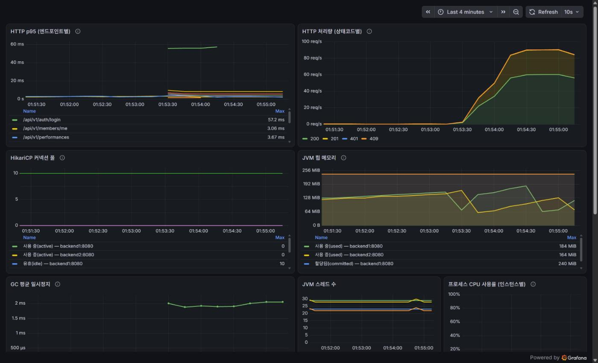
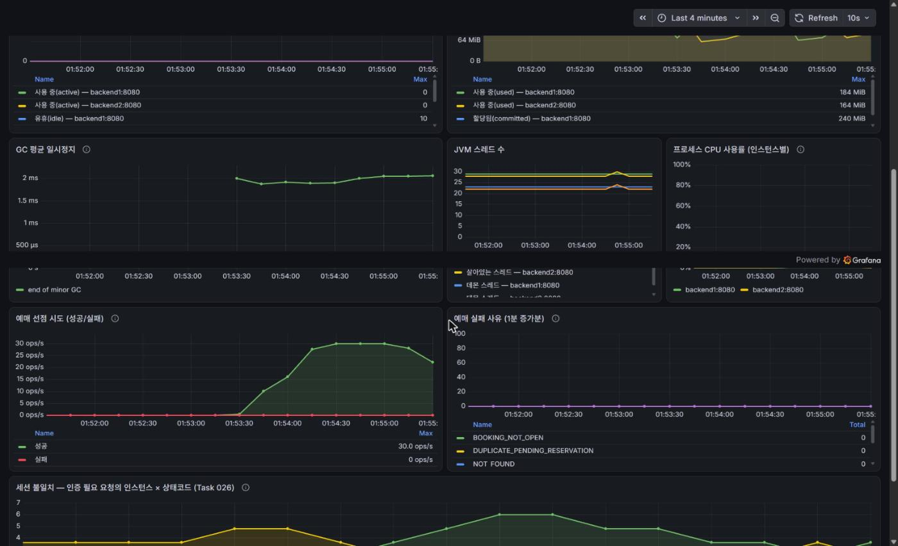

# 006. 성능 베이스라인 — 측정 도구가 틀리면 개선도 틀린다 (Task 027)

| 항목 | 내용 |
|---|---|
| 관련 Task | Task 027 (Phase 8: 성능 개선) |
| 기간 | 2026-10-12 |
| before 기준선 | [004_3](004_3-monitoring.md) 축 2 (`curl`+`xargs`, dev 시드 규모): 목록 p95 2.11ms / 좌석맵 p95 3.07ms / 최대 81.9 req/s · [005](005-session-scaling.md) 7.1 (redis p95 3.76ms) |
| 결론 | **k6 채택.** 결정적 이유는 성능이 아니라 기존 Prometheus/Grafana에 remote write로 바로 꽂힌다는 것과 스크립트가 PR로 리뷰된다는 것이다. 기준선은 600만 행에서 탐색 p95 **2.36ms** / 좌석맵 **6.72ms** / 예매 **7.43ms**(82.2 req/s) |
| 알게 된 것 | **`http_req_failed`만 보면 이 서비스를 측정할 수 없다.** 좌석 경쟁에서 밀린 요청이 409라서, 서버가 초과 판매를 막아낸 측정이 "실패율 12%"로 나온다 |
| 데이터 | `schedule_seats` **6,026,894행** (994MB), 생성 **70초** |

---

## 1. 왜 만들었나

Phase 7까지의 성능 수치는 전부 `curl` + `xargs`로 쟀다. 그래서 세 문서가 같은 한계를 남겼다.

> **부하 발생이 `curl` + `xargs`다.** 램프업도 없고 think time도 없고 응답 검증도 없다.
> 제대로 된 베이스라인은 k6를 도입하는 Task 027이 만든다. — [004_3](004_3-monitoring.md) 9절

> 방향이 분명하지만 절대값으로 읽으면 안 된다. — [005](005-session-scaling.md) 9절

> HOT 측정 표본이 6건이다. Task 027 부하 테스트에서 다시 재야 한다. — [004](004-seatmap-migration.md) 9절

Task 028(쿼리·인덱스)과 029(캐싱)의 before/after를 믿을 수 있게 재려면 그 전에 **측정 도구와
데이터 규모**가 있어야 한다. 이 Task의 산출물은 "개선"이 아니라 **이후 모든 개선의 기준선**이다.

### 1.1 왜 k6인가 — JMeter / Locust와 비교

ROADMAP 기술 스택 표에 k6가 적혀 있었지만 비교 근거가 문서에 없었다. Task 027의 요구조건
(램프업, think time, 응답 검증, 도착률 기반 스파이크, p95/TPS/에러율)을 기준으로 다시 따졌다.

| | k6 | JMeter | Locust |
|---|---|---|---|
| VU 모델 | goroutine (VU당 ~1-5MB) | OS 스레드 1개/VU | gevent (단일 프로세스 = 코어 1개) |
| 스크립트 리뷰 | JS 텍스트 → git diff 가능 | **XML → diff 불가** | Python → 가능 |
| 도착률(open model) | `constant/ramping-arrival-rate` 내장 | Throughput Shaping Timer 플러그인 | 직접 구현 |
| 합격 기준 | `thresholds` → exit code 비0 | 플러그인/수동 | 직접 구현 |
| Prometheus 연동 | **remote write 내장** | 서드파티 플러그인 | 서드파티 exporter |
| 분산 부하 | OSS는 약함(k6-operator/k8s) | master/slave 내장 | master/worker 간단 |

**결정적 이유는 성능이 아니라 두 가지다.**

1. **이미 Prometheus + Grafana가 있다**(Task 025). k6는 Grafana Labs 제품이라
   `-o experimental-prometheus-rw` 한 줄로 부하 생성기 지표가 같은 Prometheus에 들어간다.
   JMeter/Locust는 InfluxDB나 서드파티 exporter를 추가로 띄워야 하고, 그러면 성능 개선을
   하러 와서 모니터링 배관부터 다시 깔게 된다.
2. **스크립트가 PR로 리뷰된다.** 이 레포는 "재현 → 해결 → 수치"를 커밋 증거로 남기는 구조다.
   `.jmx` XML은 "think time 300ms → 500ms"가 diff에서 안 보여 수치의 재현성이 깨진다.
   `thresholds`는 합격 기준을 코드로 박고 위반 시 exit code를 비0으로 낸다.

**Gatling은 기각했다.** injection profile로 도착률을 지원하고 리포트도 좋지만 Scala/Java DSL
러닝커브가 있고 Prometheus 연동이 Enterprise 기능이다.

> [!warning] 확인 필요
> "k6가 가장 낫다"가 아니라 "이 프로젝트에 k6가 맞다"다. 모니터링 스택이 없는 프로젝트라면
> JMeter의 내장 HTML 리포트가 더 실용적이고, 시나리오가 복잡한 상태를 들고 있어야 하면
> Locust가 편하다. 1번 근거가 사라지면 결론도 바뀐다.

---

## 2. 측정 환경

| 항목 | 내용 |
|---|---|
| 호스트 | Windows 11, 16 코어, RAM 31GB (Docker Desktop) |
| 스택 | `docker-compose.prod.yml` — nginx 1 + BE 2 + FE 1 + PostgreSQL 15.18 + Redis 7.4 + Prometheus + Grafana |
| 부하 생성기 | k6 2.3.0, **같은 호스트의 compose 서비스**(`--profile load`) |
| 진입 경로 | `http://nginx` → backend1/backend2 라운드로빈 (실제 사용자와 같은 경로) |
| 세션 저장소 | Redis (`AUTH_SESSION_STORE=redis`) |
| 데이터 | `schedule_seats` **6,026,894행** / 공연 1,000 / 회차 3,000 / 좌석 2,000석(회차당) / 계정 500 |
| 결과 수집 | k6 터미널 요약 + Prometheus remote write (`k6_*` 시리즈) |
| 반복 | 시나리오별 **3회**, 표의 값은 중앙값 |
| 유지 구간 | 90초 (+ 램프업 15초 / 램프다운 10초) |

> [!warning] 확인 필요
> **부하 생성기와 측정 대상이 같은 호스트에서 돈다.** BE 2대 + PostgreSQL(600만 행) + Redis +
> Prometheus + Grafana + k6가 한 노트북에 있다. 아래 수치에서 BE CPU 최대가 8.3%라
> 이번 부하 수준에서는 CPU 경쟁이 결론을 바꿀 정도는 아니었지만, 부하를 더 올리면
> p95가 서버 지연인지 생성기 굶주림인지 구분할 수 없게 된다. 9절 참조.

**유지 구간을 90초로 둔 이유**는 004_3 4.4절이다. Prometheus `scrape_interval`이 10초라서
Gauge(Hikari 풀, 힙)는 10초마다 찍히는 스냅샷이고, 짧은 부하에서는 마침 유휴인 순간에 걸려
피크를 통째로 놓친다. 18초 부하에서 Hikari `active` 최대가 0으로 나온 적이 있다.
90초는 그 9배라 유지 구간에서만 샘플이 9개 이상 잡힌다.

---

## 3. 데이터 준비 — 600만 행을 어떻게 넣었나

`load-test/sql/` 아래 독립 SQL로 둔다. **Flyway로 넣지 않는다** — 600만 행을 마이그레이션에
두면 체크섬 검증 대상이 되어 모든 기동에 따라붙고, `db/seed`처럼 프로필 토글이 필요해진다.

규모는 역산했다. `schedule_seats` 600만 ÷ 회차당 2,000석 = **회차 3,000개**. 공연 1,000개 ×
회차 3개다. 공연장은 **1곳만** 만들었다 — 좌석은 venue 단위 공유 자원이라(V4 주석) 공연장이
하나면 `seats`는 2,000행뿐이고 늘어나는 건 `schedule_seats` 하나다. 테이블별 행 수가
"회차 × 좌석" 하나로만 커져서 측정 결과를 해석하기 쉽다.

| 파일 | 내용 | 소요 |
|---|---|---|
| `01-bulk-catalog.sql` | venue 1 → seats 2,000 → 공연 1,000(전부 `ON_SALE`) → 회차 3,000 → 등급 12,000 | **0.45초** |
| `02-bulk-schedule-seats.sql` | `schedule_seats` 600만 행 | **70초** |
| `03-loadtest-members.sql` | 계정 500개 | 즉시 |
| `98-reset-reservations.sql` | 예약 취소 + 좌석 복구 (측정 반복용) | **0.73초** |
| `99-teardown.sql` | 부하 데이터 전체 삭제 | - |

### 3.1 인덱스를 떼지 않아도 됐다

계획 단계에서 가장 걱정한 부분이 여기였다. `schedule_seats`에는 FK 4개와
`uk_schedule_seats_schedule_seat`가 걸려 있어서 "600만 행 INSERT가 수십 분 걸리면
인덱스를 `DROP` → `INSERT` → 재생성으로 바꿔야 한다"고 적어뒀다.

**실측은 10만 행당 1.12~1.25초로 일정했고 전체 70초였다.** 60개 청크의 경과 시간이 거의
변하지 않았다 — 인덱스가 커져도 삽입 속도가 떨어지지 않았다는 뜻이다. 그래서 운영과 같은
테이블 모양(`fillfactor 90` + 인덱스 없는 `status`/`reservation_id`)을 그대로 유지했다.

청크를 나눈 이유는 속도가 아니라 세 가지다.

- 한 트랜잭션이 길게 열렸다가 실패하면 전부 롤백된다. 청크마다 `COMMIT`하면 중단되어도
  거기까지는 남고, 재실행이 "좌석이 아직 없는 회차"부터 이어서 채운다.
- 청크별 경과 시간이 `NOTICE`로 찍혀서 "10만 행에 몇 초"를 별도 측정 없이 알 수 있다.
- 작게 먼저 재볼 수 있다 (`CALL load_test_fill_schedule_seats(5)` = 1만 행).

`DO` 블록이 아니라 프로시저(`CALL`)로 만든 이유는 `COMMIT`이다. `DO` 블록은 트랜잭션 안에서
돌아서 `COMMIT`을 쓸 수 없다.

### 3.2 계정을 500개 만든 이유

`uk_reservations_pending_member_grade`(V3_2)가 `(member_id, ticket_grade_id)`에 PENDING을
1건만 허용한다. 한 계정으로 예매를 루프 돌리면 **2회차부터 전부 409
`DUPLICATE_PENDING_RESERVATION`**이고, 이걸 모르면 "에러율 99%"를 서버 문제로 오진한다.

가입 API로 만들지 않았다. 500번의 BCrypt 해싱이 전부 BE에서 돌아 `setup` 단계가 몇 분
걸리고, 그 시간이 측정 구간 바로 앞에 CPU 스파이크로 남는다. 비밀번호 평문이 같으면 해시를
재사용해도 로그인되므로 dev 시드의 `"Password1!"` 해시를 그대로 복사했다.

---

## 4. 핵심 발견

### 4.1 `http_req_failed`만 보면 이 서비스를 측정할 수 없다

k6 내장 `http_req_failed`는 HTTP 상태코드만 본다. 그런데 이 서비스는 좌석 경쟁에서 밀린
요청에 **409 `SOLD_OUT`**을 돌려준다 — 서버가 초과 판매를 막아낸 결과이지 장애가 아니다.

경쟁을 강제한 측정(`SEAT_STRATEGY=head`, 1회차에 400 도착/s)에서 두 지표가 정반대를 가리켰다.

| 지표 | 값 | 판정 |
|---|---|---|
| `http_req_failed` | **12.12%** (2,402 / 19,816) | 임계값 `rate<0.01` 초과 → **테스트 실패** |
| `tikkit_real_errors` (커스텀) | **0.00%** (0 / 19,814) | **통과** |
| `checks` | 100.00% (23,441 / 23,441) | 통과 |
| `tikkit_hold_success` | 32.84% (1,175 / 3,577) | - |

**둘 다 맞다.** 요청의 12%가 409를 받았고, 그 409는 전부 서버가 의도적으로 던진
비즈니스 예외다. 서버 쪽 카운터가 같은 이야기를 한다.

| | `tikkit_reservation_attempts_total` | `http_server_requests` (POST /reservations) |
|---|---|---|
| 성공 | 1,215 | 201: 1,215 |
| `SOLD_OUT` | **2,451** | 409: 2,194 |
| `UNEXPECTED` | 0 | 500: 0 |
| 인증 실패 | - | **401: 0** |

그래서 `lib/api.js`에 (상태코드 → `ErrorCode`) 화이트리스트를 두고 "정상적 거절"과
"진짜 에러"를 가르는 커스텀 `Rate`를 따로 만들었다.

```js
const EXPECTED_REJECTIONS = {
  409: [
    'SOLD_OUT',                      // 좌석 경쟁에서 밀렸다 (조건부 UPDATE가 0건 반환)
    'DUPLICATE_PENDING_RESERVATION', // 같은 회원 + 등급에 PENDING이 이미 있다
    'RESERVATION_EXPIRED',           // 10분 홀드가 지난 뒤 결제를 시도했다
    'INVALID_STATUS_TRANSITION',     // 이미 결제/취소된 예약을 다시 건드렸다
  ],
};
```

`curl` + `xargs`로는 이 구분이 애초에 불가능했다. 004_3과 005의 "200 비율"은 409를 실패로
세거나 아예 세지 않았고, 둘 다 틀린 숫자다.

### 4.2 k6는 iteration마다 VU의 쿠키 자르를 비운다

예매 시나리오를 처음 돌렸을 때 선점 요청 182건 중 **132건이 401 UNAUTHORIZED**였다.

의도는 "VU당 한 번만 로그인하고 세션을 재사용한다"였다. 매 iteration마다 로그인하면
BCrypt 검증(의도적으로 느리다 — 4.3절에서 p95 54ms)이 측정에 계속 섞이고, 세션이
iteration마다 새로 생겨 Redis 쓰기가 실제보다 많아진다. 모듈 스코프는 VU별로 독립이므로
`let loggedIn = false`로 플래그를 두면 될 거라고 봤다.

**틀렸다. k6는 iteration이 끝날 때마다 VU의 기본 쿠키 자르를 비운다.** 1번 iteration에서
받은 `JSESSIONID`가 2번으로 넘어가지 않는다. 플래그는 유지되는데 쿠키만 사라지니,
"이미 로그인했다"고 판단하고 인증 없이 요청을 보내는 상태가 됐다.

해결은 자르를 직접 만들어 명시적으로 넘기는 것이다.

```js
// 모듈 스코프는 VU별로 독립이고 iteration 경계를 넘어 살아있다.
const vuJar = new http.CookieJar();
// ...
const params = { tags: { step: label, name: label }, jar: vuJar };
```

**이 401이 Task 026의 세션 불일치와 증상이 완전히 같다**는 점이 중요하다. `lib/api.js`가
401을 "진짜 에러"로 분류하게 둔 덕분에 바로 걸렸다. 409 SOLD_OUT에 섞여 묻혔으면
"경쟁이 심하네"로 넘겼을 것이다.

### 4.3 `login`의 p95가 54ms다 — 다른 엔드포인트의 7~27배

Prometheus의 `step` 태그별 p95(10초 창의 중앙값, keepalive ON):

| step | p95 |
|---|---|
| **login** | **54ms** |
| seatmap | 8ms |
| reservation_create | 6ms |
| reservation_pay | 5ms |
| reservation_cancel | 4ms |
| ticket_grades | 3ms |
| performance_list | 3ms |
| performance_detail | 2ms |

BCrypt(10 라운드) 비용이다. 설계대로 느린 것이므로 문제가 아니지만, **측정 설계에는 영향이
크다.** 매 iteration마다 로그인하는 스크립트를 썼다면 전체 p95가 로그인 하나에 끌려갔을 것이고,
Task 028에서 쿼리를 2ms 개선해도 그 변화가 보이지 않는다. 4.2의 "VU당 1회 로그인"은
편의가 아니라 측정 정확성 문제였다.

### 4.4 측정하려고 붙인 모니터링이 측정 때문에 망가진다 — 카디널리티 3,255개

2분짜리 측정 3회를 돌린 뒤 `k6_http_req_duration_p95`의 시리즈가 **3,255개**였다.
k6가 `name`과 `url`을 시스템 태그로 붙이는데, 비워두면 **요청 URL 전체**가 들어간다.

```
k6_http_req_duration_p95{name="http://nginx/api/v1/schedules/80/seats", url="...", ...}
k6_http_req_duration_p95{name="http://nginx/api/v1/schedules/81/seats", url="...", ...}
k6_http_req_duration_p95{name="http://nginx/api/v1/performances/543",   url="...", ...}
```

회차 3,000개와 예약 id가 전부 라벨이 된다. k6를 고른 결정적 이유가 Prometheus 연동이었는데,
기본 설정 그대로 쓰면 그 Prometheus를 망가뜨린다.

**Task 025가 서버 쪽에서 했던 것과 같은 종류의 작업이다** — 그때는 히스토그램 버킷 범위를
잘라 카디널리티를 줄였고(004_3 4.2절), 이번엔 부하 생성기 쪽 라벨을 자른다. 두 곳을 고쳤다.

```js
// lib/api.js — name을 템플릿 이름으로 고정해 경로 변수를 지운다
tags: { step: label, name: label }

// lib/config.js — 기본 시스템 태그에서 url을 뺀다 (name만으로는 부족하다)
export const SYSTEM_TAGS = ['proto','status','method','name','group','check',
                            'error_code','scenario','expected_response'];
```

`setup()`의 원시 `http.get`도 같은 문제를 일으켜 `name: 'setup_list'` / `'setup_detail'`로
고정했다. `error`를 빼고 `error_code`만 남긴 이유는 `error`가 자유 문자열이라 메시지마다
시리즈가 생기고 `error_code`는 유한한 숫자 집합이기 때문이다.

| | before | after |
|---|---|---|
| `k6_http_req_duration_p95` 시리즈 | **3,255개** | **18개** |

### 4.5 nginx에 `keepalive 32;`만 켜면 아무 일도 일어나지 않는다

005 4.6절이 "성능 비교 단계에서는 `keepalive`를 켠 값도 따로 재서 양쪽을 문서에 남긴다"고
적어두고 `# keepalive 32;`를 주석으로 준비해 뒀다. 그런데 **전제조건이 빠져 있었다.**

클라이언트가 보낸 `Connection` 헤더는 업스트림으로 그대로 전달된다. 브라우저나 k6가
`Connection: close`를 보내면 nginx→BE 커넥션도 매번 닫히고, 그러면 켜고도 "효과 없다"는
오결론이 나온다. 아래 한 줄이 같이 있어야 한다.

```nginx
proxy_http_version 1.1;          # 이미 있었다
proxy_set_header Connection "";  # 없었다 — 이게 keepalive의 전제조건이다
```

### 4.6 예약을 DELETE하면 끝나지 않는다 — 12분을 넘기고 중단했다

측정을 반복하려면 좌석을 AVAILABLE로 되돌려야 한다. 선점은 10분 홀드이고 만료 배치는
10분이 지나야 치우므로, 짧은 측정을 연달아 돌리면 좌석이 소진된 상태로 남는다.
그러면 **다음 측정이 조용히 다른 것을 잰다** — 좌석맵에 빈자리가 없으면 예매 iteration이
선점 요청 없이 조기 종료하므로 "선점 처리량"이 아니라 "좌석맵 조회 처리량"이 측정된다.
실제로 그렇게 나왔다(두 번째 실행의 선점 시도가 **0건**이었다).

리셋 스크립트를 처음에 이렇게 썼다.

```sql
DELETE FROM reservation_seats WHERE reservation_id IN (...);
DELETE FROM reservations      WHERE id IN (...);
```

**12분이 지나도 끝나지 않아 `pg_terminate_backend`로 끊었다.** 원인은 V4의 설계 결정이다 —
`schedule_seats.reservation_id`에는 인덱스가 없다. 모든 선점/해제가 그 컬럼을 갱신하므로
인덱스가 있으면 HOT 업데이트가 깨지기 때문에 **의도적으로** 뺐다.

그래서 예약 1건을 지울 때마다 Postgres가 "이 예약을 참조하는 좌석이 남아있나"를 확인하려고
`schedule_seats` 600만 행을 풀스캔한다. 예약이 13,798건이면 그게 13,798번이다.

두 가지를 고쳐서 **0.73초**가 됐다.

1. **좌석 해제는 `reservation_seats`를 경유한다.** `WHERE ss.reservation_id IN (...)`은
   풀스캔이지만, `uk_reservation_seats_reservation_seat (reservation_id, schedule_seat_id)`로
   좌석 id를 찾고 `schedule_seats`의 PK로 꽂으면 인덱스를 탄다.
   V4 주석이 "좌석 해제는 `reservation_seats`를 경유한다"고 적어둔 경로가 이것이다.
2. **예약은 지우지 않고 `CANCELLED`로 바꾼다.** FK 검사가 아예 없고, 측정 반복에 필요한
   두 조건이 다 충족된다 — 좌석은 1번에서 이미 풀렸고,
   `uk_reservations_pending_member_grade`는 PENDING에만 걸린 부분 인덱스라 풀린다.

곁가지로 하나 더 확인했다. **psql을 죽여도 서버 쿼리는 계속 돈다.** 백그라운드 명령을
중단한 뒤에도 `pg_stat_activity`에 그 `DELETE`가 `active`로 남아 다음 실행을 락으로 막았다.

### 4.7 예매 시나리오는 기본 설정으로 좌석 경쟁을 만들지 못한다

처음 측정에서 `tikkit_hold_success`가 **100%**였다. 선점이 한 번도 실패하지 않았다는 뜻이고,
"오픈런 스파이크"라는 이름과 맞지 않는다.

이유가 둘이다.

- **동시 VU가 1개뿐이었다.** `ramping-arrival-rate`로 30 도착/s를 걸었는데 iteration이
  약 44ms라 필요한 VU가 1.3개다. `preAllocatedVUs: 50`이어도 실제 동시 실행은 1개다.
  동시 요청이 없으면 경쟁이 성립하지 않는다.
- **좌석 풀이 너무 크다.** 2,000석에서 무작위 시작점으로 1~4석을 집으면 VU끼리 겹칠 확률이
  거의 0이다.

도착률을 400/s로 올려 동시 VU를 16개까지 띄워도 경쟁은 안 생겼다. 대신 좌석이 **소진**되면서
`SOLD_OUT`이 아니라 조기 종료로 나타났다(4.6과 같은 현상).

그래서 좌석 선택 전략을 `SEAT_STRATEGY` 환경변수로 갈랐다.

| 값 | 동작 | 용도 |
|---|---|---|
| `random` (기본) | 무작위 시작점에서 연속 선택 | **기준선** — 경쟁 때문에 롤백된 요청이 수치에 섞이지 않는다 |
| `head` | 전원이 앞좌석부터 선택 | **경쟁 재현** — 좌석이 정확히 겹쳐 409 SOLD_OUT이 난다 |

기본값을 `random`으로 둔 이유는 이 Task의 산출물이 "경쟁 하에서의 수치"가 아니라 기준선이기
때문이다. 경쟁 정확성은 Task 018~022의 동시성 테스트가 이미 증명했다.
`head`는 4.1의 지표 검증과 Task 033(대기열 비교)에서 쓴다.

### 4.8 서버측 401이 항상 분당 6건이다 — Task 026 패널이 영구히 켜져 있다

측정 후 합격 기준으로 "인증 실패 0건"을 확인하다가 서버 쪽에 401이 꾸준히 찍히는 걸 봤다.
k6는 `tikkit_real_errors` 0%였는데 서버는 15분에 89건이었다.

```
$ docker logs tikkit-nginx-prod | grep '" 401 '
172.21.0.8 [...] "GET /api/v1/members/me HTTP/1.1" 401 upstream=172.21.0.6:8080 sess=- rt=0.003
172.21.0.8 [...] "GET /api/v1/members/me HTTP/1.1" 401 upstream=172.21.0.5:8080 sess=- rt=0.003
```

`172.21.0.8`은 **frontend 컨테이너**다. compose 헬스체크가 10초마다 `/`를 받아보는데,
그 페이지의 Server Component가 쿠키 없이 `/api/v1/members/me`를 호출한다(`sess=-`).
분당 6건이 정확히 10초 주기다. **부하와 무관하게 항상 흐르는 배경 트래픽**이고 내가 만든 게 아니다.

004_3이 "backend 헬스체크가 `/actuator/health`로 `http_server_requests`를 오염시킨다"고
적었는데, 같은 종류의 두 번째 오염원이 frontend 쪽에 있었다.

**영향이 더 큰 쪽은 Task 026 대시보드다.** "세션 불일치 — 인증 필요 요청의 인스턴스 ×
상태코드" 패널은 `uri="/api/v1/members/me"`의 상태코드를 인스턴스별로 그린다. 그러니
**정상 상태에서도 두 인스턴스 모두 401을 계속 찍는다.** 진짜 세션 불일치가 나도
"원래 그랬던 것"과 구분이 안 된다. 패널의 전제가 깨져 있는 셈이다.

이번 Task에서는 손대지 않았다 — k6 쪽 401을 세는 것으로 합격 기준은 성립하고,
패널 수정이나 frontend 헬스체크 변경은 범위 밖이다(10절에 남긴다).

### 4.9 `docker compose run`이 측정 중에 BE를 재생성한다

`docker compose run k6`를 그냥 쓰면 compose가 의존 서비스까지 올리면서 backend1/backend2를
**재생성**한다. 그러면 두 가지가 동시에 망가진다 — JVM 워밍업이 초기화되고, nginx가
기동 시점에 해석한 옛 IP를 물고 있어서 502가 난다(nginx.conf 상단 주석이 경고한 그 함정).

`--no-deps`가 필수다.

```bash
docker compose -f docker-compose.prod.yml --profile load run --rm --no-deps k6 run ...
```

### 4.10 `K6_PROMETHEUS_RW_LABELS`는 컨테이너가 아니라 compose가 치환한다

실행 회차를 구분하려고 `K6_PROMETHEUS_RW_LABELS: "run=${K6_RUN_LABEL:-local}"`을 뒀는데,
`docker compose run -e K6_RUN_LABEL=card-test`로 넘기면 라벨이 `run=local`로 남는다.
compose가 `${}`를 **YAML 파싱 시점에 호스트 환경변수로** 치환하기 때문이다.
호스트 환경변수로 줘야 한다.

```bash
K6_RUN_LABEL=kaon-seatmap-1 docker compose -f docker-compose.prod.yml --profile load run ...
```

---

## 5. 실제로 만든 것

### 5.1 k6 compose 서비스

`docker-compose.prod.yml`에 `profiles: ["load"]`로 추가했다. `up`으로 띄우지 않고
`run --rm --no-deps`로 한 번씩 호출한다 — 시나리오를 바꿔 여러 번 돌려야 하는 one-shot이고,
프로필에 넣어두면 평소 `up`/e2e에서는 아예 뜨지 않는다. 별도 compose 파일로 쪼개지 않은 것은
기존 관례와 같다(`down`에서 `-f`를 빼먹으면 orphan이 남는다).

호스트 바이너리로 돌리지 않은 이유는 compose 네트워크 합류다. `http://nginx`와
`prometheus:9090`을 서비스명으로 쓸 수 있고, 호스트에서는 BE(8080)에 접근할 수 없다
(포트를 퍼블리시하지 않는다). k6 설치 상태가 환경마다 달라지는 문제도 없어진다.

### 5.2 Prometheus remote write

`docker-compose.prod.yml`의 prometheus `command`에 한 줄 추가했다.

```yaml
- --web.enable-remote-write-receiver
```

**이 플래그가 없으면 `/api/v1/write`가 404로 떨어지고, k6는 에러 없이 조용히 아무것도
남기지 않는다.** 확인은 빈 POST로 한다 — 400이 정상(빈 바디 거부), 404면 플래그 누락이다.

이걸 켜는 이유는 하나다. **k6의 p95와 BE의 Hikari/힙/GC를 같은 타임라인에서 보려는 것.**
004_3에서 가장 번거로웠던 게 부하 생성기 수치와 서버 수치를 눈으로 맞추는 작업이었다.

### 5.3 시나리오 3종

| 파일 | executor | think time | VU/도착률 |
|---|---|---|---|
| `browse.js` | `ramping-vus` | 0.5~2.0s | VU 50 |
| `seatmap.js` | `ramping-vus` | 1.0~4.0s | VU 30 |
| `booking-spike.js` | `ramping-arrival-rate` | **없음** | 30 도착/s |

**think time과 executor를 짝지어야 한다.** arrival-rate executor는 페이싱을 스스로
통제하므로 `sleep()`을 넣으면 설정한 도착률이 그대로 깨진다.

**오픈런을 도착률로 모델링한 이유**가 이 Task에서 가장 중요한 설계 결정이다.
`ramping-vus`는 closed model이다 — 각 VU가 응답을 받고 나서 다음 요청을 보내므로 서버가
느려지면 들어오는 부하도 같이 줄어든다. "서버가 느려질수록 편해지는" 현실에 없는 상황을
측정하게 된다. 오픈런은 서버가 느려져도 사람들이 계속 들어오는 상황(open model)이다.
Task 033에서 대기열 유무를 비교할 때 이 차이가 결과를 바꾼다.

`discardResponseBodies`는 켜지 않았다. 세 시나리오 모두 응답에서 id를 꺼내 다음 요청으로
넘어가야 하고, 바디를 버리면 응답 크기가 측정에서 빠져 실제보다 빠른 수치가 나온다.
좌석맵은 2,000석에 약 238KB다.

### 5.4 nginx keepalive

`keepalive 32;`를 켜고 전제조건인 `proxy_set_header Connection "";`을 추가했다(4.5절).

### 5.5 기각한 것 — 임계값에 p95를 넣지 않았다

`thresholds`에 지연 임계값을 일부러 뺐다.

```js
export const BASE_THRESHOLDS = {
  http_req_failed: ['rate<0.01'],
  tikkit_real_errors: ['rate<0.001'],
  checks: ['rate>0.99'],
};
```

이 Task가 그 기준선을 **만드는** 단계라서 근거 없는 숫자를 박으면 매번 빨개지고 아무 정보도
주지 않는다. 7절의 실측값이 Task 028/029의 회귀 감지선이 되고, 그때 이 객체에 넣는다.

---

## 6. 관문 — nginx가 Task 026부터 계속 unhealthy였다

범위 밖이지만 막혀서 고쳐야 했던 것. k6 서비스에 `depends_on: nginx: service_healthy`를
걸었더니 `dependency failed to start: container tikkit-nginx-prod is unhealthy`로 기동이
막혔다.

호스트에서 `curl http://localhost/healthz`는 **200**이다. 컨테이너 안에서는 다르다.

```
$ docker exec tikkit-nginx-prod wget -q -O /dev/null http://localhost/healthz
wget: can't connect to remote host: Connection refused
$ docker exec tikkit-nginx-prod wget -q -O /dev/null http://127.0.0.1/healthz
(성공)
$ docker exec tikkit-nginx-prod netstat -ltn
tcp  0  0  0.0.0.0:80  0.0.0.0:*  LISTEN
```

컨테이너 `/etc/hosts`에 `::1 localhost`가 있어서 busybox wget이 IPv6를 먼저 시도하는데,
nginx의 `listen 80;`은 IPv4만 바인딩한다.

**내가 만든 문제가 아니다.** `git show HEAD:nginx/nginx.conf`로 원본 설정을 띄워도 똑같이
실패한다. 지금까지 드러나지 않은 이유는 **nginx가 healthy해지기를 기다리는 서비스가
하나도 없었기 때문**이다(frontend는 backend1을 기다리고, nginx는 아무도 기다리지 않는다).
k6가 처음으로 걸렸다.

헬스체크 URL을 `127.0.0.1`로 바꿨다. `listen [::]:80;`을 추가하는 쪽은 퍼블리시된 포트의
동작을 바꾸므로 고르지 않았다.

---

## 7. 수치

### 7.1 기준선 (keepalive ON, 600만 행, 3회 중앙값)

| 시나리오 | p50 | **p95** | p99 | 처리량 | iteration/s | 진짜 에러 |
|---|---|---|---|---|---|---|
| 탐색 (VU 50) | 1.66ms | **2.36ms** | 2.78ms | 35.5 req/s | 11.8 | **0** |
| 좌석 조회 (VU 30) | 5.68ms | **6.72ms** | 8.34ms | 10.8 req/s | 10.6 | **0** |
| 예매 (30 도착/s) | 4.82ms | **7.43ms** | 9.36ms | **82.2 req/s** | 27.2 | **0** |

3회 반복의 산포가 매우 작았다 — 탐색 p95가 2.31 / 2.36 / 2.40ms, 좌석맵이 6.71 / 6.72 / 6.90ms,
예매가 7.35 / 7.43 / 7.60ms다. 005의 "60초 1회씩만 쟀다" 한계는 닫혔다.

좌석맵 응답: 평균 **237.9KB** / **2,000석** (p95 239.6KB). 004_3의 59KB는 dev 시드
공연장(350~3,150석)이 섞인 값이었다.

### 7.2 keepalive on/off (3회 중앙값)

005 4.6절이 남긴 "핸드셰이크 비용이 지연 측정에 섞인다"를 분리했다.

| 시나리오 | OFF p95 | **ON p95** | 차이 | OFF avg | ON avg |
|---|---|---|---|---|---|
| 탐색 | 2.68ms | **2.36ms** | **-0.32ms (-11.9%)** | 1.88ms | 1.66ms |
| 좌석 조회 | 7.40ms | **6.72ms** | **-0.68ms (-9.2%)** | 6.34ms | 5.72ms |
| 예매 | 7.98ms | **7.43ms** | **-0.55ms (-6.9%)** | 5.62ms | 5.42ms |

처리량은 양쪽이 같았다(탐색 35.1 vs 35.5 req/s, 예매 82.2 vs 82.2 req/s) — 이번 부하 수준이
서버 한계와 멀어서 커넥션 재사용이 처리량을 바꾸지 못했다.

**절대값은 0.2~0.7ms로 작지만 p95의 7~12%다.** Task 028/029가 노리는 개선폭이 같은
자릿수이므로, keepalive를 끈 상태로 before를 재면 개선 효과의 상당 부분이 핸드셰이크
노이즈에 묻힌다. 그래서 켠 상태를 기준선으로 고정했다.

### 7.3 Grafana — 부하 생성기와 서버가 같은 타임라인에 있다



예매 시나리오 1회(램프업 15초 → 유지 90초 → 램프다운 10초)를 거는 동안의 화면이다.
처리량이 **82 req/s**에서 평평해지고 201/409/200이 상태코드별로 갈린다.
`/api/v1/auth/login`의 p95가 **57.2ms**로 다른 엔드포인트(3ms 대)와 한 자릿수 다른 축에
있는 것도 그대로 보인다(4.3절).



Task 025에서 만든 예매 패널이다. 성공이 **30 ops/s**까지 올라가고 실패가 **0**이다 —
`SEAT_STRATEGY=random`(기본)이라 좌석 경쟁이 없었다(4.7절).

> [!warning] 확인 필요
> 이 캡처에서 HikariCP `active`의 Max가 **0**으로 보인다. 7.4의 "최대 1"과 어긋나는 게
> 아니라, `scrape_interval`이 10초라 이 4분 창의 샘플이 마침 전부 유휴 순간에 걸린 것이다.
> 004_3 4.4절이 경고한 바로 그 함정이고, Gauge는 이렇게 짧은 창에서 신뢰할 수 없다.
> 7.4의 값은 측정 구간 전체(25분)에 `max_over_time`을 건 것이다.

### 7.4 서버 지표 (측정 구간 전체)

| 항목 | Task 025 (dev 시드, `curl`) | **Task 027 (600만 행, k6)** | 비고 |
|---|---|---|---|
| Hikari `active` 최대 | 1 | **1** (경쟁 시 4) | 풀 10 |
| Hikari `pending` 최대 | 0 | **0** | 둘 다 포화 없음 |
| Hikari `idle` 최소 | 9 | **9** | |
| heap 최대 | 142.8MB | **188.8MB** | 데이터 규모 반영 |
| BE CPU 최대 | 3.2% | **4.2%** (경쟁 시 8.3%) | 16코어 기준 |
| live threads 최대 | - | **30** | 신규 측정 |
| 최대 처리량 | 81.9 req/s | **82.2 req/s** | 생성기가 다르다(*) |

(*) 처리량이 같은 건 우연이 아니라 양쪽 다 서버 한계가 아니기 때문이다. `curl`+`xargs`는
병렬 20이 상한이었고, k6는 도착률 30/s를 설정값으로 걸었다. 둘 다 "서버가 낼 수 있는 최대"가
아니다 — 9절 참조.

**가장 중요한 결과는 Hikari다.** 004_3이 "풀 10이 이 워크로드에는 과하다"고 결론 냈는데
그건 dev 시드 규모였다. 이 Task의 관문은 "600만 행에서 뒤집히면 그 자체가 Task 028의 입력"
이었고, **뒤집히지 않았다.** `active` 최대가 그대로 1이고 `pending`은 0이다.
좌석맵이 237KB를 내려주는 동안에도 커넥션은 금방 반납된다는 뜻이다.

### 7.5 경쟁 구간 (`SEAT_STRATEGY=head`, 1회차, 400 도착/s, 1회)

| 항목 | 값 |
|---|---|
| 동시 VU 최대 | 16 |
| 처리량 | 441.7 req/s / 334.6 iteration/s |
| p95 | 12.62ms (p99 18.39ms) |
| 선점 성공률 | **32.84%** (1,175 / 3,577) |
| `http_req_failed` | **12.12%** |
| `tikkit_real_errors` | **0.00%** |
| 서버 `SOLD_OUT` | 2,451 |
| 서버 500 / 401 | **0 / 0** |

표본 1회라 수치를 절대값으로 읽으면 안 된다. 이 측정의 목적은 4.1의 지표 설계를 검증하는
것이었고, 그건 확인됐다.

### 7.6 카디널리티

| | before | after |
|---|---|---|
| `k6_http_req_duration_p95` 시리즈 | 3,255개 | **18개** |

---

## 8. 왜 `step` 태그로 엔드포인트를 가르나

Task 025의 서버측 대시보드는 Spring이 주는 `uri` 라벨을 쓴다. `/api/v1/schedules/{id}/seats`
처럼 **템플릿이 그대로** 들어오므로 카디널리티가 안전하다. k6에는 그런 게 없다 — 요청한
URL밖에 모른다(4.4절).

그래서 `lib/api.js`의 래퍼가 모든 요청에 `step` 태그를 직접 붙인다. 부작용으로 양쪽을
교차 검증할 수 있게 됐다.

| | k6 (`step="seatmap"`) | 서버 (`uri="/api/v1/schedules/{id}/seats"`) |
|---|---|---|
| p95 | 6.72ms | 8.17ms |

서버 쪽이 더 큰 게 이상해 보이지만 집계가 다르다. k6는 실행 전체의 p95이고, 서버는
`histogram_quantile`을 1분 창에 적용한 값의 측정 구간 최대다. 게다가 서버 p95는 버킷 경계
보간 추정값이다(004_3 4.1절의 함정). **같은 축으로 비교할 수 없으므로 7.1의 기준선은 k6
쪽을 쓴다.** 서버 지표는 "그 시각에 서버 내부가 어땠나"를 보는 데만 쓴다.

---

## 9. 한계

- **부하 생성기와 측정 대상이 같은 호스트에서 돈다.** BE 2대 + PostgreSQL(600만 행) + Redis +
  Prometheus + Grafana + k6가 16코어 한 대에 있다. 이번에는 BE CPU 최대가 8.3%라 결론을
  바꾸지 않았지만, 부하를 더 올리면 p95가 서버 지연인지 생성기 굶주림인지 구분할 수 없다.
  분산 부하는 k6 OSS에서 k8s(k6-operator)가 필요해 범위 밖이다.
- **이 수치는 "한계 용량"이 아니라 "저부하 구간의 지연"이다.** BE CPU 최대 4.2%, Hikari
  `pending` 0으로 서버가 거의 놀고 있다. 탐색 VU 50 / 좌석맵 VU 30 / 예매 30 도착/s는
  모두 설정값이고 서버가 못 버텨서 멈춘 지점이 아니다. **포화점을 찾지 않았다** —
  `ramping-arrival-rate`를 계단식으로 올리는 breakpoint 테스트는 Task 033으로 넘긴다.
- **경쟁은 기본 설정에서 재현되지 않는다**(4.7). `SEAT_STRATEGY=head`로만 나오고, 그
  측정은 1회뿐이다. 즉 7.1의 기준선은 "경쟁 없는 상태"의 수치다.
- **좌석 경쟁이 좌석 소진과 섞인다.** 좌석맵에 빈자리가 없으면 선점 요청이 아예 안 나가고
  iteration이 조기 종료한다(4.6). 이 경우 `tikkit_hold_success`에 샘플이 안 쌓여서
  "경쟁이 없었다"와 "요청을 안 보냈다"를 구분할 수 없다. 조기 종료용 Counter를 안 만들었다.
- **예매 시나리오가 PENDING을 결제/취소로 즉시 해소한다.** 실제 사용자는 10분 동안 좌석을
  붙잡고 고민하는데, 그 상태의 재고 압박은 재지 않았다.
- **BE 2대 중 어디로 갔는지를 분해하지 않았다.** 005처럼 `instance` 라벨로 분포를 보지
  않았다. 401이 0건이라 세션은 정상이지만, 라운드로빈이 50:50인지는 확인하지 않았다.
- **데이터가 균일하다.** 1,000개 공연이 전부 같은 공연장·같은 좌석 수·같은 등급 구성이고
  `ON_SALE`이다. 실제 카탈로그는 공연장 규모와 상태가 섞이므로 `idx_performances_status_start_date`가
  타는 선택도가 다르다. Task 028의 `EXPLAIN ANALYZE`에서 이 균일성이 결과를 왜곡할 수 있다.
- **예약 행이 측정마다 쌓인다.** `98-reset-reservations.sql`이 삭제가 아니라 `CANCELLED`로
  바꾸므로(4.6) `reservations`가 계속 커진다. 측정을 수십 번 반복하면 그 자체가 변수다.
- **`02`의 멱등성 단위가 회차다.** 한 회차의 좌석을 일부만 넣고 중단하면 재실행이 그 회차를
  "이미 처리됨"으로 건너뛴다(`NOT EXISTS`가 회차 단위라서). 청크마다 `COMMIT`하므로
  실제로 그 상태가 되려면 INSERT 중간에 끊겨야 하는데, 가능한 경로다.
- **디스크를 1GB 쓴다.** `schedule_seats`가 994MB이고 DB 전체가 1,011MB다. `99-teardown.sql`로
  지워도 Postgres는 DELETE로 디스크를 반납하지 않는다 — `VACUUM FULL`이나 볼륨 삭제가 필요하다.
  Prometheus 보존 7일도 같이 쌓인다.
- **Grafana 대시보드에 k6 패널을 추가하지 않았다.** `k6_*` 시리즈가 Prometheus에 들어오지만
  `tikkit-backend.json`은 서버 지표만 그린다. 같은 타임라인 비교는 Explore에서 수동으로 했다.
- **nginx `worker_connections 1024`를 건드리지 않았다.** 경쟁 측정에서 441 req/s까지 갔는데
  502/504는 없었다. 다만 한계를 확인한 게 아니라 안 부딪혔을 뿐이다.
- **`proxy_*_timeout`이 설정돼 있지 않다.** nginx 기본 60s가 작용한다. 이번 측정에서
  타임아웃은 없었지만 포화 구간에서는 이 값이 에러 모양을 결정한다.

---

## 10. 다음 단계

- **[Task 028] 쿼리·인덱스 최적화**: 7.1이 before 기준선이다. 좌석맵 p95 **6.72ms**와
  탐색 p95 **2.36ms**를 같은 조건(keepalive ON, 600만 행, 3회 중앙값)으로 다시 재서 비교한다.
  7.4의 Hikari `active` 1 / `pending` 0도 같이 봐야 한다 — 쿼리가 빨라지면 커넥션 점유
  시간이 줄어드는데, 이미 포화가 아니라서 **풀 지표로는 개선이 안 보일 것이다.**
  N+1 탐지는 지표가 아니라 SQL 로그/쿼리 카운트로 해야 한다.
  9절의 "데이터가 균일하다"를 `EXPLAIN ANALYZE` 해석에서 반드시 감안한다.
- **[Task 029] 캐싱 적용**: 탐색 시나리오가 페이지를 50개 중 무작위로 넘기도록 짰다
  (`browse.js`). 0페이지만 보면 Postgres 버퍼 캐시에 같은 블록만 올라가서 before가 이미
  캐시된 상태로 측정된다. 캐시 적용 후에는 **적중률을 따로 재야** p95 개선이 캐시 덕인지
  확인할 수 있다.
- **[Task 030] 렌더링 성능**: 좌석맵 응답이 **237.9KB / 2,000석**이다. FE가 이걸 한 번에
  받아 그리므로 Lighthouse 측정 전에 이 크기를 전제로 잡아야 한다.
- **[Task 033] 오픈런 부하 검증**: `booking-spike.js`의 `ramping-arrival-rate`가 그대로
  쓰인다. 다만 **9절의 "포화점을 찾지 않았다"를 먼저 닫아야 한다** — 대기열 유무를 비교하려면
  대기열 없이 서버가 무너지는 지점을 알아야 하고, 그게 breakpoint 테스트다.
  경쟁은 `SEAT_STRATEGY=head`로 만든다(4.7).
- **[미배정] k6 Grafana 패널**: `k6_*` 시리즈를 `tikkit-backend.json`에 넣어 부하 생성기
  p95와 Hikari/힙을 한 화면에서 본다. 지금은 Explore에서 수동으로 맞춰야 한다.
- **[미배정] 세션 불일치 패널의 전제가 깨져 있다**(4.8): frontend 헬스체크가 10초마다
  쿠키 없이 `/members/me`를 호출해서 **정상 상태에서도 401이 분당 6건** 찍힌다. 진짜 불일치가
  나도 배경 트래픽과 구분되지 않는다. 패널 쿼리에서 `sess=-`에 해당하는 요청을 걸러내거나
  (지금 지표에는 그 정보가 없다) frontend 헬스체크 경로를 바꿔야 한다.
- **[Task 034] 운영 반영**: `--web.enable-remote-write-receiver`는 Prometheus를 쓰기
  가능하게 연다. 로컬 전용 스택이라 그대로 뒀지만 공개 환경에서는 인증이나 네트워크 격리가 필요하다.

**범위 밖에서 발견한 것**:

- **nginx 헬스체크가 Task 026부터 계속 실패하고 있었다**(6절). 아무도 기다리지 않아서
  드러나지 않았다. 이번에 `127.0.0.1`로 고쳤다 — 이건 k6 기동을 막아서 고치지 않을 수 없었다.
- **예약 삭제가 `schedule_seats` 풀스캔을 유발한다**(4.6). 부하 테스트에서는 `CANCELLED`로
  우회했지만, 운영에서 예약을 물리 삭제할 일이 생기면 같은 벽에 부딪힌다.
  `schedule_seats.reservation_id` 인덱스를 추가하면 HOT 업데이트가 깨지므로(V4의 설계 결정)
  정답은 "삭제하지 않는다"일 수 있다. Task 028에서 인덱스를 손댈 때 같이 판단한다.
- **`load-test/k6/lib/accounts.js`의 `maxVUs`가 계정 수에 묶여 있다.** 500개를 넘는 VU를
  띄우면 계정이 겹쳐서 `uk_reservations_pending_member_grade`에 걸린다. Task 033에서
  VU를 더 띄우려면 `03-loadtest-members.sql`의 500을 같이 올려야 한다. 손대지 않았다.

---

## 재현 방법

```bash
# 1. 스택 기동 (모니터링 포함)
cp .env.example .env
docker compose -f docker-compose.prod.yml --profile monitoring up -d --build
docker compose -f docker-compose.prod.yml restart nginx    # BE 재생성 시 필수 (옛 IP를 물면 502)

# 2. remote write 수신 확인
curl -s -o /dev/null -w '%{http_code}\n' -X POST http://localhost:9090/api/v1/write
# -> 400 이 정상(빈 바디 거부). 404 면 --web.enable-remote-write-receiver 누락

# 3. 대량 데이터 주입 (01: 0.45초 / 02: 70초 / 03: 즉시)
for f in load-test/sql/01-bulk-catalog.sql load-test/sql/02-bulk-schedule-seats.sql \
         load-test/sql/03-loadtest-members.sql; do
  docker compose -f docker-compose.prod.yml exec -T postgres \
    psql -q -U "$POSTGRES_USER" -d "$POSTGRES_DB" -v ON_ERROR_STOP=1 -f - < "$f"
done
# -> 02 가 청크마다 NOTICE를 찍는다: "회차 50 개 처리 (이번 100000 행 / 누적 ...)"
# -> schedule_seats_total 약 6,000,000

# 4. 기준선 측정 (시나리오 3종 x 3회). --no-deps 가 필수다 (4.8절)
for s in browse seatmap booking-spike; do for i in 1 2 3; do
  K6_RUN_LABEL="kaon-$s-$i" docker compose -f docker-compose.prod.yml --profile load \
    run --rm --no-deps k6 run -o experimental-prometheus-rw \
    --summary-export=/results/${s}-kaon-${i}.json /scripts/${s}.js
done; done
# -> 3종 모두 checks 100%, tikkit_real_errors 0.00%, exit code 0
# -> 탐색 p95 약 2.4ms / 좌석맵 약 6.7ms / 예매 약 7.4ms (82 req/s)

# 5. 측정 사이에 좌석 복구 (0.73초). 안 하면 다음 측정이 다른 걸 잰다 (4.6절)
docker compose -f docker-compose.prod.yml exec -T postgres \
  psql -q -U "$POSTGRES_USER" -d "$POSTGRES_DB" -f - < load-test/sql/98-reset-reservations.sql
# -> available = 6026894 / not_available = 0

# 6. 경쟁 재현 — http_req_failed 와 tikkit_real_errors 가 갈리는 것을 본다 (4.1절)
K6_RUN_LABEL=contention docker compose -f docker-compose.prod.yml --profile load \
  run --rm --no-deps -e SEAT_STRATEGY=head -e SAMPLE_SCHEDULES=1 -e PEAK_RATE=400 \
  -e DURATION=30s k6 run -o experimental-prometheus-rw /scripts/booking-spike.js
# -> tikkit_hold_success 약 33%, http_req_failed 약 12% (임계 초과로 실패)
# -> tikkit_real_errors 0.00% (통과), checks 100%

# 7. 엔드포인트별 p95 (초 단위다 — 0.008 = 8ms)
curl -s --get http://localhost:9090/api/v1/query \
  --data-urlencode 'query=quantile by (step) (0.5, max_over_time(k6_http_req_duration_p95{step!=""}[25m]))'
# -> login 0.054 (BCrypt) / seatmap 0.008 / reservation_create 0.006 / performance_list 0.003

# 8. 카디널리티 확인 (4.4절)
curl -s --get http://localhost:9090/api/v1/query \
  --data-urlencode 'query=count(k6_http_req_duration_p95)'
# -> 18 내외. 수천이면 systemTags 설정이 빠진 것이다

# 9. 서버 지표 교차 검증
curl -s --get http://localhost:9090/api/v1/query \
  --data-urlencode 'query=max(max_over_time(hikaricp_connections_active[25m]))'
curl -s --get http://localhost:9090/api/v1/query \
  --data-urlencode 'query=sum by (reason) (increase(tikkit_reservation_attempts_total[25m]))'
# -> active 최대 1 (경쟁 시 4), pending 0
# -> 경쟁 측정 후에는 SOLD_OUT 이 수천 건, UNEXPECTED 0

# 9-1. 서버측 401은 0이 되지 않는다 — frontend 헬스체크다 (4.8절)
curl -s --get http://localhost:9090/api/v1/query \
  --data-urlencode 'query=sum(rate(http_server_requests_seconds_count{status="401"}[5m]))*60'
# -> 분당 6건 (10초 주기). 이보다 많으면 그때 세션을 의심한다
docker logs tikkit-nginx-prod --since 5m | grep '" 401 '
# -> 전부 frontend 컨테이너 IP + sess=- (쿠키 없음)

# 10. keepalive off 비교 (nginx/nginx.conf 의 keepalive 32; 와
#     proxy_set_header Connection ""; 두 줄을 주석 처리 -> restart -> 4번 재실행)
docker compose -f docker-compose.prod.yml restart nginx

# 11. 정리 (DELETE 로는 디스크가 안 줄어든다 — 볼륨을 비우는 쪽이 빠르다)
docker compose -f docker-compose.prod.yml exec -T postgres \
  psql -q -U "$POSTGRES_USER" -d "$POSTGRES_DB" -f - < load-test/sql/99-teardown.sql
# 또는
docker compose -f docker-compose.prod.yml down -v
```
